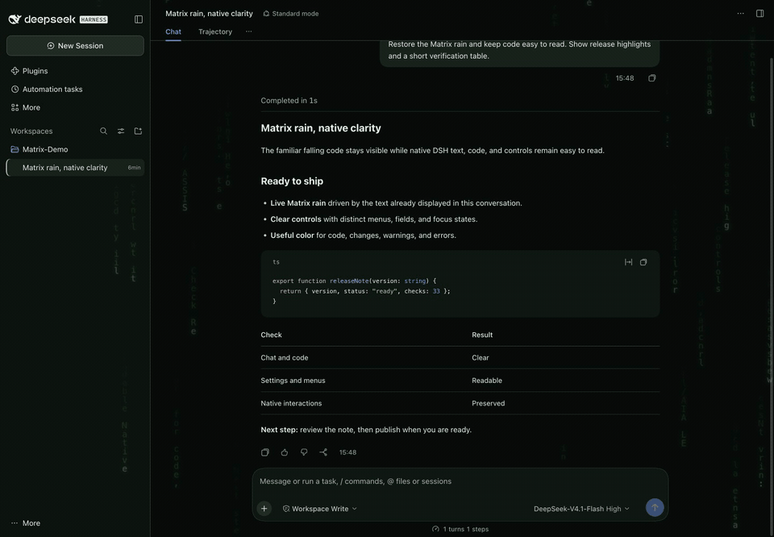
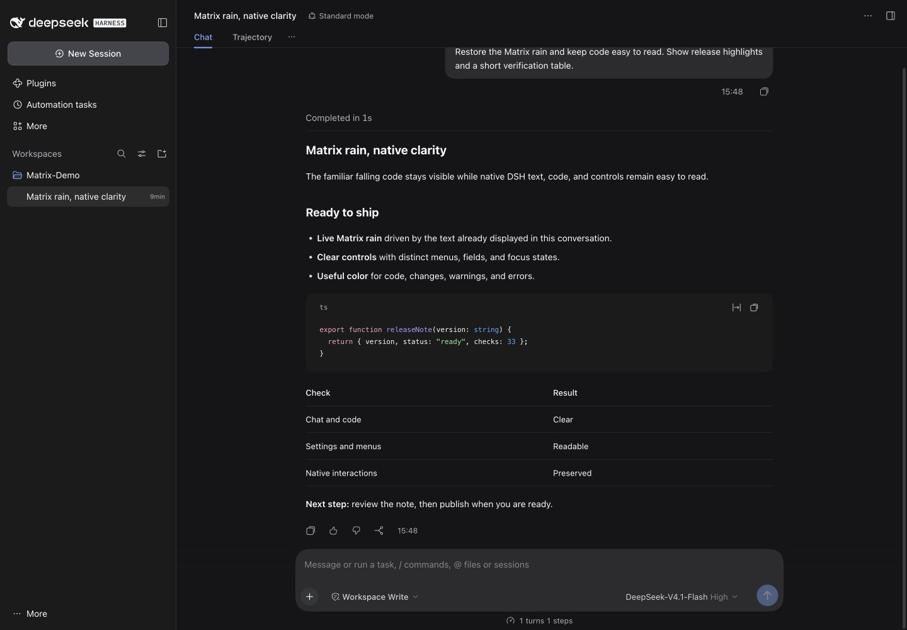
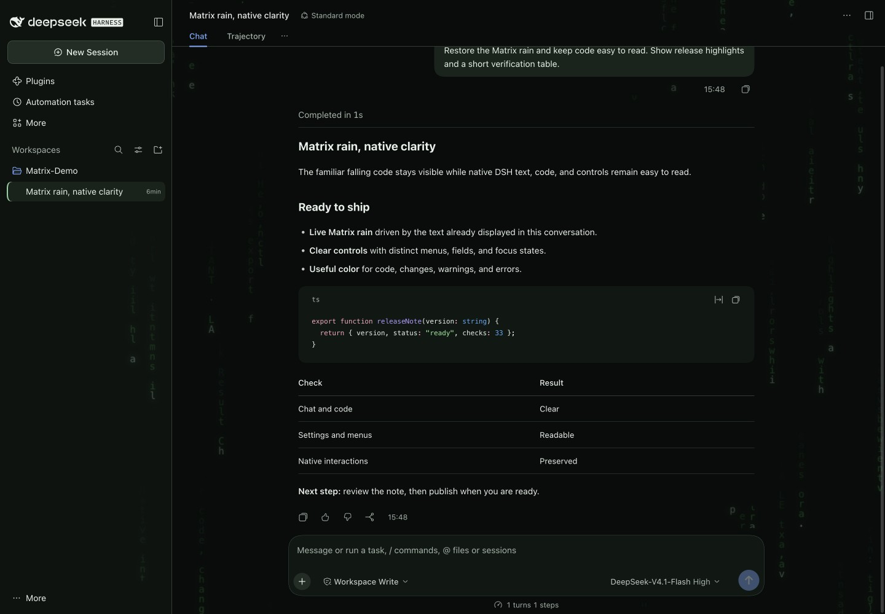
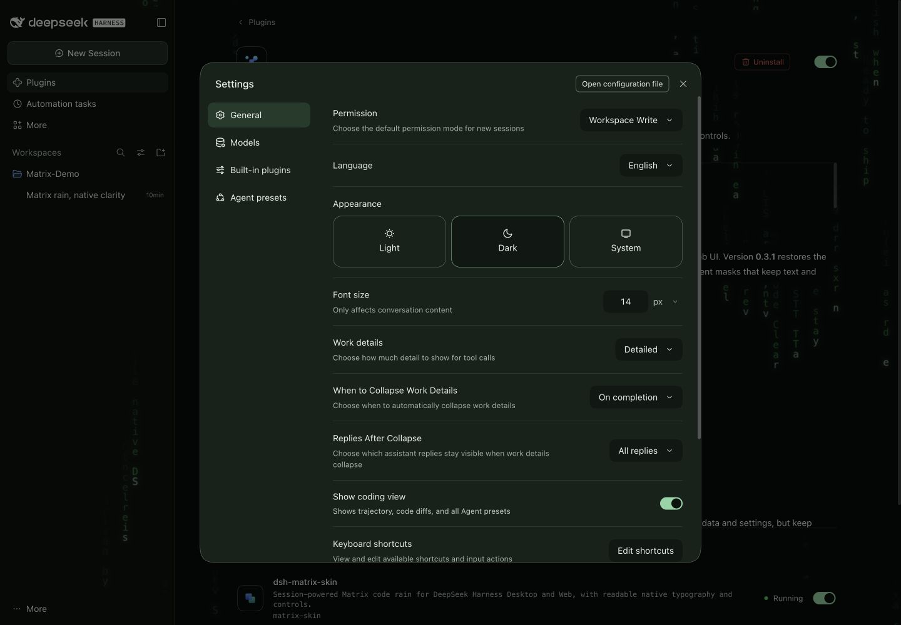

# DSH Matrix Skin

English | [中文](README.zh.md)

> Session-powered Matrix code rain, with room to read.

**DSH Matrix Skin** brings animated, session-powered Matrix code rain to the [DeepSeek Harness](https://github.com/deepseek-ai/deepseek-harness) Desktop and Web UI. Version **0.3.1** restores the original rain renderer's motion, color, and intensity across conversations, typing, navigation, and settings, with content masks that keep text and controls clear.



**The Matrix look, built for everyday coding.** Independent community plugin · MIT · No plugin telemetry

[Install in Desktop](#install-and-enable) · [Screenshots and demo](#screenshots-and-demo) · [Version 0.3.1](https://github.com/emeryxu1-blip/dsh-matrix-skin/releases/tag/v0.3.1)

## Install and enable

### Official Desktop app

1. Open **DeepSeek Harness** from Applications.
2. Choose **Plugins → Add plugin** and enter `github:emeryxu1-blip/dsh-matrix-skin`.
3. Install and enable the bundle, then restart the app if requested.

You can launch the app normally afterward; no Terminal command is needed. Desktop and Web share conversation data and settings, but keep plugin installations separate. Installing in `web` does not enable the skin in `desktop`.

For command-line installation, first launch Desktop once, fully quit it, and use the command supplied by Desktop's **Manage dsh Command…** menu:

```bash
dsh plugin --profile desktop add github:emeryxu1-blip/dsh-matrix-skin
```

Reopen Desktop from Applications. Use the Desktop-supplied command, since npm-installed DSH cannot modify the managed Desktop profile.

### Web profile

```bash
dsh plugin --profile web add -w github:emeryxu1-blip/dsh-matrix-skin
dsh web
```

Installation enables the skin automatically. Open or hard-refresh the DSH Web UI after it starts. The repository ships its built client artifacts, so installation does not require a post-install build.

## Highlights

- A consistent dark palette with clearly separated surfaces and text tiers
- Native light appearance retained, with a restrained green accent
- Native text and code fonts, font-size preferences, spacing, and disclosure controls
- Existing syntax highlighting, diff colors, error/warning states, and terminal colors preserved
- The original rain renderer's falling characters, trails, glow, motion, color, and intensity
- Rain continues during conversations, typing, navigation, and settings; masks protect working text and controls
- Dark and native light appearances both retain visible code rain
- No floating status HUD, scanline overlay, glowing text, or extra composer labels
- Reduced-motion and forced-colors preferences hide decorative rain
- Local-only processing with no telemetry or session-content upload

> The plugin can use only reasoning that the model provider sends to DSH. It cannot recover hidden, redacted, or unavailable reasoning.

## Screenshots and demo

These are genuine DeepSeek Harness `0.2.2-rc.3` Web UI captures on macOS, using an isolated demo profile with fictional content and the actual Matrix Skin plugin. Desktop `0.2.2-rc.3` was also inspected separately; these browser captures do not depict native desktop window chrome.

| Native DSH (skin disabled) | Matrix Skin 0.3.1 |
| --- | --- |
|  |  |



[Watch the 24.5-second code-rain recording](https://github.com/emeryxu1-blip/dsh-matrix-skin/releases/download/v0.3.1/matrix-skin-demo.mp4). The animated preview and recording capture the actual running DSH Web UI with fictional demo content. [Capture details](https://raw.githubusercontent.com/emeryxu1-blip/dsh-matrix-skin/v0.3.1/docs/images/capture-provenance.json).

## Requirements

- DeepSeek Harness Desktop `0.2.2-rc.3` or the matching Web runtime
- The `desktop` profile for the official app, or `web` for browser use

Version `0.3.1` retains support for the Desktop Session Controller and its separate navigation store, the current CSS-module class format, and native message-bubble markers. The legacy `0.1.0-rc.6`, `0.1.1-rc.2`, and `0.1.5-rc.1` Web contracts remain supported. It borrows the selected session without retaining it or opening history, and never installs an obsolete client runtime.

## Provider and plugin independence

Matrix Skin changes presentation only. Model/provider dropdowns, Effort choices, defaults, request parameters, authentication, and retries remain owned by DSH and any separately installed provider plugin. Using the official DeepSeek API keeps DSH's native options; this skin contains no company endpoints, network checks, model catalogs, or gateway setup.

A separate gateway/retry plugin can be enabled, disabled, or removed independently. Matrix uses only the read-only session feed and its own `dsh-matrix-*` DOM markers, style element, and cleanup owner; it does not replace another plugin's controls or patch provider services.

## Use

Use DSH normally—no plugin configuration is required.

1. Open the Desktop app, or start DSH Web with `dsh web`.
2. Select or create a session.
3. Read and work normally; conversation text, menus, settings, files, previews, and terminals keep native behavior.
4. Expand or collapse native **Think** rows as usual. Reasoning uses DSH’s font-size preferences and conversation scrolling.

Code rain stays active across normal use. The original rain renderer provides the motion, color, and intensity; content masks leave room for reading and interacting with DSH. Typing, opening a menu, or visiting settings does not turn it off. Reduced-motion and forced-colors preferences hide the decoration, and background pages pause it. The bounded local text feed uses the bundled official DSH README until selected-session text is available, including startup on Settings or Plugins.

## Verify

Confirm the package is installed:

```bash
dsh plugin --profile web why dsh-matrix-skin
```

Confirm its bundle layer is active:

```bash
dsh --profile web --dump-config
```

Look for the `dsh-matrix-skin` layer and its `matrix-skin` entry. In current DSH, open **Plugins → Installed plugins** and confirm the bundle is enabled. **Settings → Built-in plugins** shows runtime inventory. For Desktop CLI checks, fully quit the app and substitute `--profile desktop` using the Desktop-supplied command; reopen the app afterward.

## Temporarily disable

In Desktop, open **Plugins**, find **dsh-matrix-skin**, and turn it off. Restart if requested. Turn it on there to re-enable it. The file-edit instructions below are for the Web profile.

Append this entry to the existing top-level array in `~/.dsh/profiles/web/cordis.patch.yml` (or `$DSH_HOME/profiles/web/cordis.patch.yml` when `DSH_HOME` is set):

```yaml
- id: matrix-skin
  disabled: true
```

Do not replace the rest of the profile patch file. Restart `dsh web` and hard-refresh the browser. The plugin inventory will show `matrix-skin — Disabled`.

## Re-enable

Delete the `matrix-skin` override above, restart `dsh web`, and hard-refresh. The bundle's default enabled state returns.

## Update or uninstall

In Desktop, manage the bundle through **Plugins**. Use **Add plugin** with its GitHub source again when installing a new GitHub revision; use the bundle's uninstall action to remove it. Restart if requested. The commands below manage the Web installation.

```bash
# Update
dsh plugin --profile web update -w dsh-matrix-skin

# Uninstall
dsh plugin --profile web remove -w dsh-matrix-skin
```

Restart DSH Web and hard-refresh after either command. Remove any temporary `matrix-skin` override before uninstalling.

## Development

```bash
git clone https://github.com/emeryxu1-blip/dsh-matrix-skin.git
cd dsh-matrix-skin
npm test
npm run check
npm run build
```

Install the checkout into your Web profile with:

```bash
dsh plugin --profile web add -w "$PWD"
```

## Readability checks

The regression tests check contrast for the skin’s declared text/surface colors, keyboard-focus visibility, native light appearance, and preservation of native layout, typography, composer text layers, syntax highlighting, and semantic states. These are focused implementation checks, not a claim of complete accessibility or WCAG compliance. Review the assembled DSH interface at its actual window size, font settings, and appearance when changing the palette.

## Privacy

On session selection, the plugin takes one bounded in-memory snapshot of the newest records; if that window is still loading, its temporary listener detaches as soon as the initial window opens. Live rain updates then read only capped text tails from the newest rendered DSH elements (at most 1,200 characters across 64 text nodes per element and two elements per category). It does not subscribe to or rescan the full streaming session history. The derived rain buffer remains in memory only.

The plugin has no network client, telemetry, storage, credential access, or model-request interception.

DSH Matrix Skin is an independent community plugin and is not an official DeepSeek product.

## License

[MIT](LICENSE)
