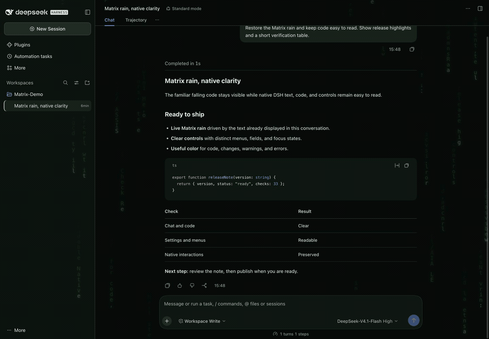
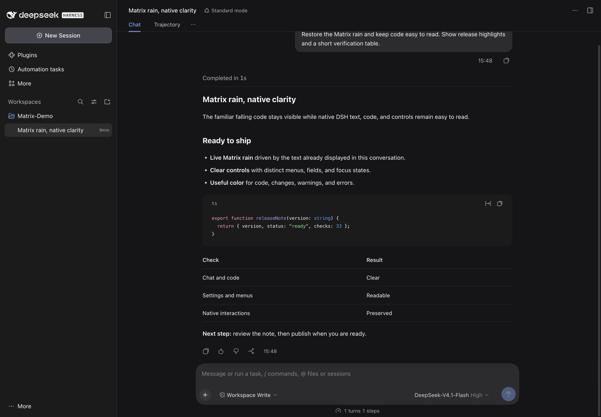
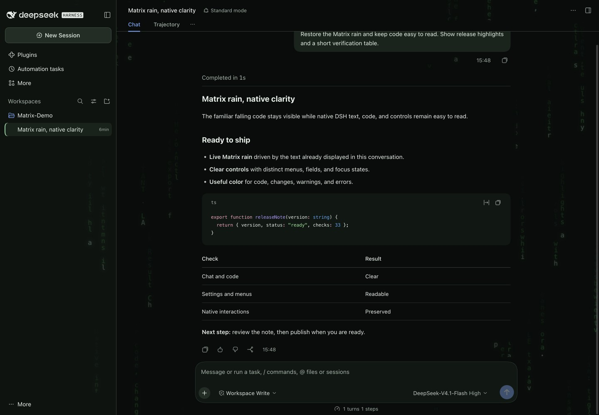
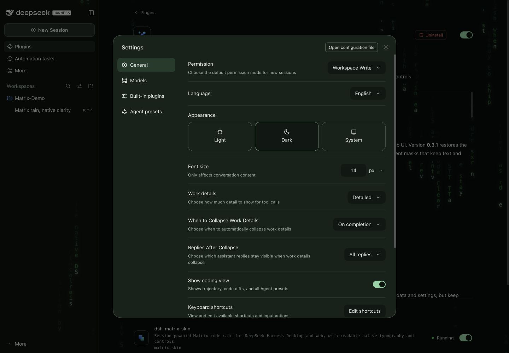

# DSH Matrix Skin

[English](README.md) | 中文

> 让会话化作 Matrix 代码雨，也留出清楚阅读的空间。

**DSH Matrix Skin** 为 [DeepSeek Harness](https://github.com/deepseek-ai/deepseek-harness) 桌面和 Web 界面带来由会话内容驱动的动态 Matrix 代码雨。**0.3.1** 恢复原有渲染器的动效、颜色与强度，让代码雨在聊天、输入、导航和设置中持续播放，并通过内容遮罩保留清楚的文字与控件。



**有 Matrix 氛围，也能认真写代码。** 独立社区插件 · MIT · 插件不含遥测

[桌面安装](#安装并启用) · [截图与演示](#截图与演示) · [0.3.1 版本](https://github.com/emeryxu1-blip/dsh-matrix-skin/releases/tag/v0.3.1)

## 安装并启用

### 官方桌面应用

1. 从「应用程序」打开 **DeepSeek Harness**。
2. 选择 **Plugins（插件）→ Add plugin（添加插件）**，输入 `github:emeryxu1-blip/dsh-matrix-skin`。
3. 安装并启用 bundle；如提示需要重启，请重启应用。

之后直接打开桌面应用即可，无需使用终端启动。Desktop 和 Web 共享会话数据和设置，但各自管理插件安装；装在 `web` 中的皮肤不会自动在 `desktop` 启用。

若要通过命令行安装，请先打开一次桌面应用，然后彻底退出，使用桌面应用菜单 **Manage dsh Command…** 提供的命令：

```bash
dsh plugin --profile desktop add github:emeryxu1-blip/dsh-matrix-skin
```

然后从「应用程序」重新打开 Desktop。必须使用桌面应用提供的命令；npm 安装的 DSH 无法修改受管理的 Desktop profile。

### Web profile

```bash
dsh plugin --profile web add -w github:emeryxu1-blip/dsh-matrix-skin
dsh web
```

安装会自动启用皮肤。DSH Web 启动后，打开页面或强制刷新即可。仓库已经包含构建后的客户端文件，安装时不需要额外执行构建脚本。

## 亮点

- 深色模式下，文字层级与背景表面保持清楚的对比
- 保留原生浅色外观，仅加入克制的绿色强调色
- 保留原生文字和代码字体、字号偏好、间距与展开/收起操作
- 保留语法高亮、差异颜色、错误/警告状态与终端颜色
- 恢复原有代码雨渲染器的下落字符、拖尾、光晕、动效、颜色和强度
- 聊天、输入、导航和设置时持续播放，通过内容遮罩保护阅读与操作区域
- 深色与原生浅色外观中都保留可见的代码雨
- 移除悬浮状态面板、扫描线、文字光晕和额外的输入框标签
- 系统要求减少动态效果或使用强制颜色时，隐藏装饰性代码雨
- 仅在本地处理，不包含遥测，也不会向外上传会话内容

> 插件只能使用模型提供商实际发送给 DSH 的 reasoning，无法恢复隐藏、脱敏或未公开的推理内容。

## 截图与演示

以下为 macOS 上真实 DeepSeek Harness `0.2.2-rc.3` Web 界面的截图，使用隔离的演示 profile、虚构内容和实际运行的 Matrix Skin 插件。Desktop `0.2.2-rc.3` 也已单独检查；这些浏览器截图不展示原生桌面窗口外框。

| 原生 DSH（皮肤停用） | Matrix Skin 0.3.1 |
| --- | --- |
|  |  |



[观看 24.5 秒代码雨实录](https://github.com/emeryxu1-blip/dsh-matrix-skin/releases/download/v0.3.1/matrix-skin-demo.mp4)。动态预览和录像来自实际运行中的 DSH Web 界面，使用虚构演示内容。[素材说明](https://raw.githubusercontent.com/emeryxu1-blip/dsh-matrix-skin/v0.3.1/docs/images/capture-provenance.json)。

## 环境要求

- DeepSeek Harness Desktop `0.2.2-rc.3` 或对应版本的 Web 运行时
- 官方桌面应用使用 `desktop` profile，浏览器版本使用 `web` profile

`0.3.1` 继续支持桌面版 Session Controller、独立的导航状态、当前 CSS Modules 类名格式和原生消息气泡标记，同时保留旧版 `0.1.0-rc.6`、`0.1.1-rc.2`、`0.1.5-rc.1` 的 Web 合约兼容性。插件只借用当前会话，不额外保留会话或打开历史，也不会安装已废弃的 client runtime。

## 提供商与插件独立性

Matrix Skin 只改变外观。模型/提供商下拉菜单、Effort 选项、默认值、请求参数、认证和重试仍由 DSH 及单独安装的提供商插件负责。使用 DeepSeek 官方 API 时保留 DSH 原生选项；皮肤不包含公司地址、网络检测、模型目录或网关设置。

独立的网关/重试插件可以单独启用、停用或卸载。Matrix 仅读取会话内容，使用自己的 `dsh-matrix-*` DOM 标记、样式元素和清理生命周期，不替换其他插件的控件，也不修改提供商服务。

## 使用

像平时一样使用 DSH 即可，无需配置插件。

1. 打开桌面应用，或使用 `dsh web` 启动 DSH Web。
2. 选择或创建一个会话。
3. 正常阅读和工作；对话、菜单、设置、文件、预览和终端保持原生行为。
4. 像平时一样展开或收起 **Think** 行。Reasoning 遵循 DSH 的字号偏好，并随对话滚动。

代码雨在日常使用中持续播放，由原有渲染器提供动效、颜色和强度，并用内容遮罩为阅读和操作留出空间。输入文字、打开菜单或进入设置不会关闭代码雨。系统要求减少动态效果或使用强制颜色时，会隐藏装饰动画；页面进入后台时暂停。当前会话文本尚不可用时，有界的本地文本源使用插件内置的 DSH 官方 README，包括直接从设置或插件页面启动的情况。

## 验证

确认插件已经安装：

```bash
dsh plugin --profile web why dsh-matrix-skin
```

确认插件层已经启用：

```bash
dsh --profile web --dump-config
```

在输出中查找 `dsh-matrix-skin` 层和 `matrix-skin` 条目。新版 DSH 在 **Plugins → Installed plugins** 中显示 bundle 的启用状态，**Settings → Built-in plugins** 显示运行时清单。检查 Desktop 时，请先彻底退出应用，再使用桌面应用提供的命令并把 profile 改为 `desktop`；完成后重新打开应用。

## 暂时停用

在 Desktop 的 **Plugins** 页面找到 **dsh-matrix-skin** 并关闭开关，按提示重启；重新打开开关即可恢复。下面的文件编辑方法适用于 Web profile。

把下面的条目追加到 `~/.dsh/profiles/web/cordis.patch.yml` 现有的顶层数组中；如果设置了 `DSH_HOME`，则使用 `$DSH_HOME/profiles/web/cordis.patch.yml`：

```yaml
- id: matrix-skin
  disabled: true
```

不要覆盖 profile patch 文件中的其他内容。重启 `dsh web` 并强制刷新浏览器后，插件列表会显示 `matrix-skin — Disabled`。

## 重新启用

删除上面的 `matrix-skin` 覆盖条目，重启 `dsh web`，然后强制刷新。插件会恢复 bundle 的默认启用状态。

## 更新或卸载

Desktop 请使用 **Plugins** 管理此 bundle。更新 GitHub 版本时，在 **Add plugin** 中再次输入 GitHub 来源；卸载时使用 bundle 的卸载操作，按提示重启。下面的命令管理 Web 安装。

```bash
# 更新
dsh plugin --profile web update -w dsh-matrix-skin

# 卸载
dsh plugin --profile web remove -w dsh-matrix-skin
```

执行任一操作后，请重启 DSH Web 并强制刷新。卸载前请先删除临时的 `matrix-skin` 覆盖条目。

## 本地开发

```bash
git clone https://github.com/emeryxu1-blip/dsh-matrix-skin.git
cd dsh-matrix-skin
npm test
npm run check
npm run build
```

把当前 checkout 安装到 Web profile：

```bash
dsh plugin --profile web add -w "$PWD"
```

## 可读性检查

回归测试检查皮肤声明的文字与表面颜色对比、键盘焦点可见性、原生浅色外观，以及原生布局、字体、输入区文字层、语法高亮和状态颜色的保留情况。这些是针对实现的检查，并不代表完整的无障碍或 WCAG 合规认证。修改配色时，还应在实际窗口尺寸、字号和外观设置下检查组合后的 DSH 界面。

## 隐私

选择会话时，插件只读取一次最新记录的有界内存快照；如果初始窗口仍在加载，临时监听会在窗口打开后立即解除。后续代码雨只读取 DSH 最新已渲染元素中有上限的文本尾部（每个元素最多 1,200 个字符、64 个文本节点，每类最多两个元素），不会订阅或反复扫描完整的流式会话历史。派生的代码雨字符缓冲区只保留在内存中。

插件没有网络 client、遥测、持久化存储、凭据访问或模型请求拦截逻辑。

DSH Matrix Skin 是独立的社区插件，并非 DeepSeek 官方产品。

## 许可证

[MIT](LICENSE)
