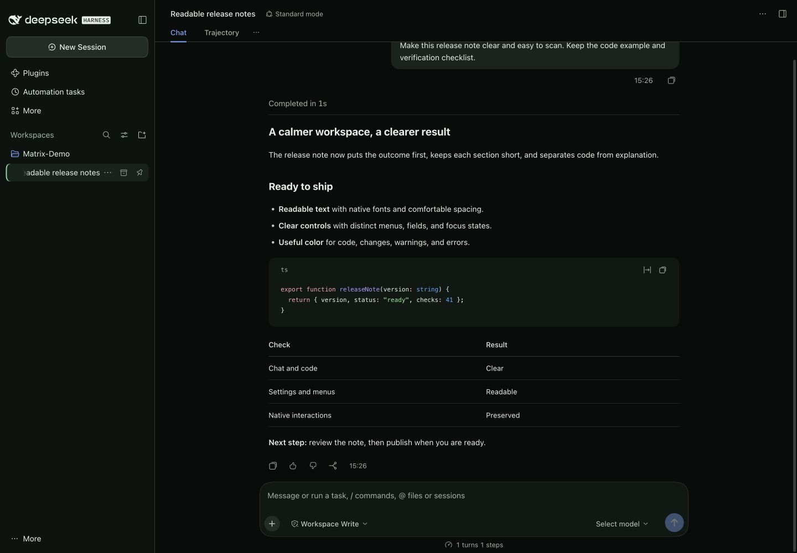
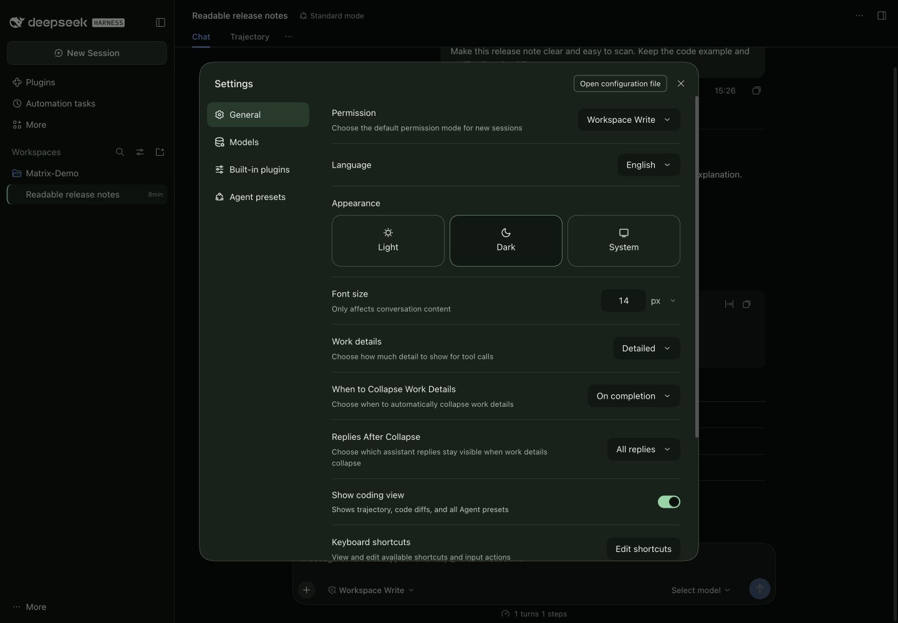

**Unofficial community project, independently developed and maintained.**

**The Matrix look, built for everyday coding.** Matrix Skin 0.3 adds restrained green accents and clear dark surfaces to DeepSeek Harness Desktop and Web, while preserving native fonts, controls, syntax highlighting, and semantic colors.

Project: https://github.com/emeryxu1-blip/dsh-matrix-skin

## What it does

- Themes the existing DSH interface through a DSH plugin bundle; it does not replace the conversation UI.
- Keeps reading, coding, settings, menus, and sidebars clear and familiar.
- Confines code rain to the empty-session welcome area, away from working content. Reduced-motion preferences disable it.
- Contains no plugin telemetry, credential access, or session-content upload logic.

[Watch the short demo](https://github.com/emeryxu1-blip/dsh-matrix-skin/releases/download/v0.3.0/matrix-skin-demo.mp4) · [0.3.0 release](https://github.com/emeryxu1-blip/dsh-matrix-skin/releases/tag/v0.3.0)

## Install in Desktop

1. Open DeepSeek Harness.
2. Choose **Plugins → Add plugin** and paste `github:emeryxu1-blip/dsh-matrix-skin#v0.3.0`.
3. Install and enable it, then restart if requested. Launch the app normally afterward.

Desktop and Web use separate plugin installations. You can disable or uninstall the skin through Plugins.

Tested by live inspection on official **DSH Desktop 0.2.2-rc.3 / macOS**, with 41 automated tests passing. The public images and video show the actual matching Web runtime in an isolated demo profile with fictional content; the 25-second video is a labeled still-capture walkthrough; they are not native desktop-window screenshots. Other OS/version combinations need further testing.

If you try it, please share your DSH version, OS, and any surface where text or controls are unclear. Readability is the priority.

## 中文

**非官方社区项目，由社区成员独立开发和维护。**

**有 Matrix 氛围，也能认真写代码。** Matrix Skin 0.3 为 DSH 桌面与 Web 界面提供克制的绿色强调色、层次清楚的深色表面，同时保留原生字体、控件、代码高亮和状态颜色。代码雨只出现在空会话欢迎区域，不遮挡实际工作；系统要求减少动态效果时会关闭。

安装：打开桌面应用 → **Plugins → Add plugin** → 粘贴 `github:emeryxu1-blip/dsh-matrix-skin#v0.3.0` → 安装并启用，按提示重启。之后正常打开桌面应用即可，无需终端启动。

插件不含遥测、凭据访问或会话内容上传逻辑。已在 macOS 上的官方 Desktop **0.2.2-rc.3** 中检查；公开图片和视频来自隔离演示 profile 的真实同版本 Web 界面，内容均为虚构演示。欢迎反馈 DSH 版本、操作系统，以及任何文字不清楚或控件难辨的位置。
