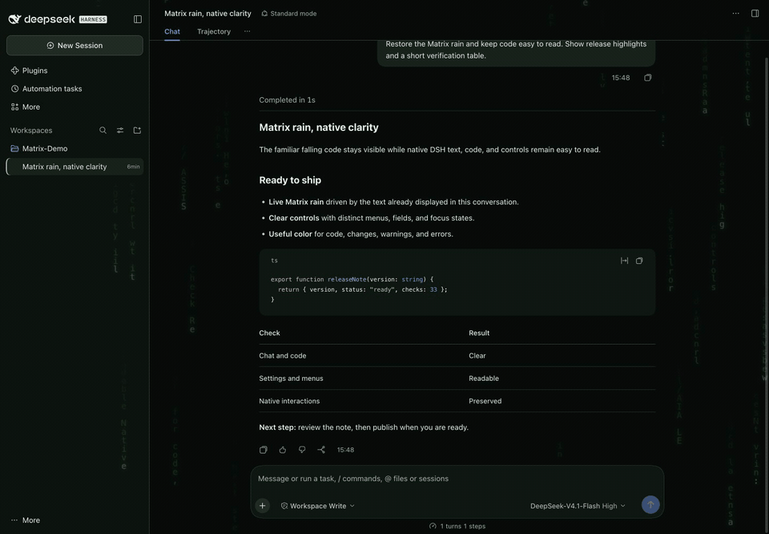

# Matrix Skin 0.3.1

Session-powered Matrix code rain, with room to read.

Unofficial community plugin for DeepSeek Harness Desktop and Web, independently developed and maintained. MIT licensed.

## What changed

- Restores the original Matrix rain renderer's falling characters, trails, glow, motion, color, and intensity, powered by the bounded local session-text feed.
- Keeps rain active during conversations, typing, navigation, menus, settings, and normal work. Content masks protect reading and interaction areas while the animation continues around them.
- Preserves native fonts, font-size preferences, layouts, controls, and reasoning disclosures, along with syntax highlighting, diffs, warning/error states, and terminal colors.
- Keeps rain visible in dark and native light appearances. Reduced-motion and forced-colors preferences hide decoration; background pages pause it.
- Keeps the text feed bounded and local. When selected-session text is not yet available, including startup on Settings or Plugins, the bundled official DSH README supplies the characters.
- Contains no telemetry, credential access, session-content upload, or model-request interception.

This release restores the animation that was restricted to empty sessions in `0.3.0`. The earlier release remains available as part of the project history.

## Install in Desktop

1. Open DeepSeek Harness normally.
2. Select **Plugins → Add plugin** and paste `github:emeryxu1-blip/dsh-matrix-skin#v0.3.1`.
3. Install and enable the bundle; restart if requested.

For later GitHub revisions, add the source again through Plugins. Desktop and Web have separate plugin installations. Web installation and removal are documented in the repository README.

## Compatibility and captures

- All **40 automated tests** pass, including moving-canvas lifecycle, session-text glyphs, content masking, and readability checks.
- Verified in the installed official DSH Desktop `0.2.2-rc.3` app on macOS and the matching Web runtime.
- The 8-second animated preview and 24.5-second code-rain recording capture the actual DSH Web UI on macOS in an isolated demo profile with fictional content. Public captures do not depict native desktop-window chrome.
- Earlier Web contracts remain in the peer dependency range; this release does not claim live testing on every historical version or OS.
- Focused contrast and interface checks do not constitute a full accessibility certification.

[Watch the 24.5-second code-rain recording](https://github.com/emeryxu1-blip/dsh-matrix-skin/releases/download/v0.3.1/matrix-skin-demo.mp4) · [Documentation](https://github.com/emeryxu1-blip/dsh-matrix-skin#readme) · [Capture details](https://github.com/emeryxu1-blip/dsh-matrix-skin/blob/v0.3.1/docs/images/capture-provenance.json) · [Report an issue](https://github.com/emeryxu1-blip/dsh-matrix-skin/issues)

## 中文

**让会话化作 Matrix 代码雨，也留出清楚阅读的空间。** `0.3.1` 恢复原有 Matrix 代码雨渲染器的下落字符、拖尾、光晕、动效、颜色和强度，使用有界的本地会话文本驱动。聊天、输入、导航、菜单和设置等日常操作中持续播放，通过内容遮罩保护阅读与操作区域，同时保留原生字体、控件、代码高亮与状态颜色。

深色和原生浅色外观中都保留代码雨；系统要求减少动态效果或使用强制颜色时会隐藏装饰动画，页面进入后台时暂停。当前会话文本尚不可用时，包括直接从设置或插件页面启动，会使用插件内置的 DSH 官方 README 提供字符。

从 DSH 桌面应用打开 **Plugins → Add plugin**，粘贴 `github:emeryxu1-blip/dsh-matrix-skin#v0.3.1`，安装并启用，按提示重启。之后正常打开桌面应用即可，无需终端启动。Desktop 和 Web 各自管理插件安装。

这是独立维护的非官方社区插件。插件不含遥测、凭据访问、会话内容上传或模型请求拦截逻辑。已在 macOS 上安装运行的官方 Desktop `0.2.2-rc.3` 及对应 Web 运行时中验证；公开界面素材来自隔离演示 profile 中的真实 Web 界面，使用虚构演示内容。

[观看 24.5 秒代码雨实录](https://github.com/emeryxu1-blip/dsh-matrix-skin/releases/download/v0.3.1/matrix-skin-demo.mp4)。页面顶部的 8 秒动态预览同样录自实际运行的界面。
